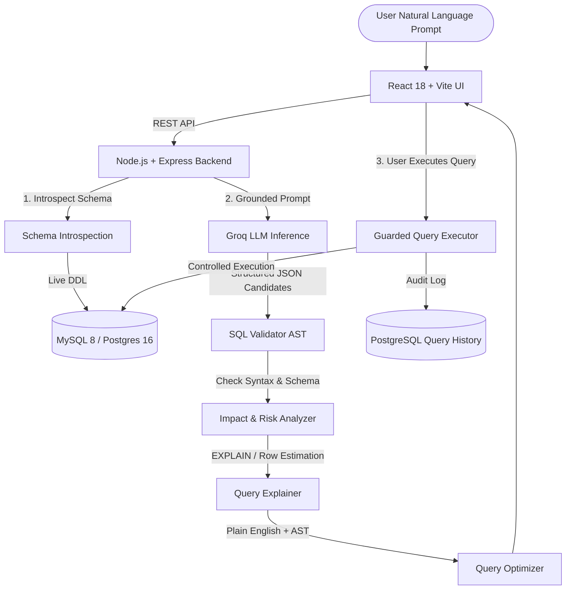

# GenAI-Powered Natural Language SQL Query Generator and Analyzer

[](https://www.typescriptlang.org/)
[](https://react.dev/)
[](https://nodejs.org/)
[](https://www.mysql.com/)
[](https://www.postgresql.org/)
[](https://groq.com/)

A full-stack, enterprise-grade AI database assistant that transforms natural language requests into **schema-grounded, syntax-validated, and safety-guarded SQL queries** across **MySQL** and **PostgreSQL** databases.

---

## 🚀 Key Features

- 🧠 **Schema-Grounded GenAI Generation**: Uses live database introspection and Groq LLMs (`openai/gpt-oss-20b` or `llama3-70b-8192`) to generate precise SQL without hallucinated columns or tables.
- 🛡️ **Multi-Tier Safety Guardrails**:
  - Automatically blocks unconstrained `UPDATE` and `DELETE` queries lacking a `WHERE` clause.
  - Blocks destructive DDL statements (`DROP`, `TRUNCATE`, `ALTER`, `GRANT`, `REVOKE`).
  - Blocks multiple SQL statements to prevent SQL injection.
- 📊 **Pre-Execution Impact Analysis**: Estimates row count impact (via `EXPLAIN` or safe `COUNT(*)` transformation) and tags queries with low, medium, or high risk levels before execution.
- 🔍 **Plain-English Query Explanation**: Breaks down queries into AST components (tables, columns, joins, aggregations, filters) and generates intuitive narrative explanations.
- ⚡ **Rule-Based & EXPLAIN Query Optimizer**: Detects performance bottlenecks (`SELECT *`, missing `LIMIT`, non-sargable functions, full table scans) and suggests optimized rewrites.
- 🎛️ **Controlled Query Execution**:
  - **Read-only (`SELECT`)**: Executed on reader pools with a mandatory row cap (500 max) and 5-second execution timeout.
  - **Mutations (`INSERT`/`UPDATE`/`DELETE`)**: Executed on writer pools inside isolated transactions with impact discrepancy rollback protection.
  - **High-risk mutations**: Explicit user confirmation required.
- 📜 **Full Query History & Auditability**: Automatically records every prompt, generated query, execution status, returned rows, and latency in PostgreSQL.
- 🎨 **Modern Dark-Mode UI**: Built with React, Vite, Tailwind CSS, Lucide icons, interactive schema sidebar, syntax highlighting, impact cards, and exportable execution tables.

---

## 🏗️ System Architecture



---

## 📋 Prerequisites

Ensure you have the following installed on your system:
- **Node.js**: v18.0.0 or higher ([Download](https://nodejs.org/))
- **npm**: v9.0.0 or higher
- **Docker & Docker Compose**: ([Install Docker Desktop](https://www.docker.com/products/docker-desktop/))
- **Groq API Key**: ([Obtain from Groq Console](https://console.groq.com/keys))

---

## ⚙️ Environment Configuration

1. Create a root `.env` file from the provided example:
   ```bash
   cp .env.example .env
   ```

2. Configure the required environment variables in `.env`:
   ```env
   PORT=3001
   FRONTEND_URL=http://localhost:5173
   
   # Groq API Configuration
   GROQ_API_KEY=gsk_your_groq_api_key_here
   GROQ_MODEL=openai/gpt-oss-20b
   
   # Database Type
   DATABASE_TYPE=mysql
   
   # MySQL Configuration
   MYSQL_HOST=localhost
   MYSQL_PORT=3306
   MYSQL_DATABASE=college_db
   MYSQL_ROOT_PASSWORD=MyRoot123
   MYSQL_READER_USER=sql_reader
   MYSQL_READER_PASSWORD=MyReader123
   MYSQL_WRITER_USER=sql_writer
   MYSQL_WRITER_PASSWORD=MyWriter123
   
   # PostgreSQL Configuration
   POSTGRES_HOST=localhost
   POSTGRES_PORT=5432
   POSTGRES_DATABASE=college_db
   POSTGRES_ROOT_PASSWORD=PgRoot123
   POSTGRES_READER_USER=sql_reader
   POSTGRES_READER_PASSWORD=PgReader123
   POSTGRES_WRITER_USER=sql_writer
   POSTGRES_WRITER_PASSWORD=PgWriter123
   
   # History Database (PostgreSQL)
   POSTGRES_READER_HISTORY_PASSWORD=PgReader123
   POSTGRES_WRITER_HISTORY_PASSWORD=PgWriter123
   
   # Security Secret
   JWT_SECRET=your_super_secret_jwt_key_here
   ```

---

## 🐳 Database Setup with Docker

Start both **MySQL 8.0** and **PostgreSQL 16** containers with automated schema creation and seed data:

```bash
docker compose up -d
```

This will initialize:
1. **`college_db` (MySQL & PostgreSQL)**:
   - `Department` table (6 seeded departments)
   - `Employee` table (70 seeded employees)
   - `Students` table (120 seeded student records)
   - Least-privilege `sql_reader` (SELECT only) and `sql_writer` users.
2. **`query_history` (PostgreSQL)**:
   - Dedicated table tracking all queries, users, execution metadata, and timestamps.

To verify container health:
```bash
docker compose ps
```

---

## 💻 Running the Application

### 1. Start the Backend Server
Open a terminal in the `backend` folder:
```bash
cd backend
npm install
npm run dev
```
The backend will validate environment variables and start at `http://localhost:3001`.

### 2. Start the Frontend Application
Open a new terminal in the `frontend` folder:
```bash
cd frontend
npm install
npm run dev
```
The frontend UI will start at `http://localhost:5173`.

---

## 🧪 Testing and Quality Assurance

### Vitest Unit & Integration Test Suite
The project includes automated tests covering all 11 testing areas defined in **Section 24 Testing Strategy** (prompt understanding, schema grounding, JOIN generation, aggregations, ambiguity, SQL validation, safety guardrails, impact analysis, dialect compatibility, execution, error handling):

```bash
cd backend
npm run test:run
```

To run tests in watch mode:
```bash
npm test
```

---

## 📈 Evaluation & Benchmark Suite

The project includes an automated evaluation benchmark (`backend/scripts/evaluate.ts`) containing **32 natural language prompts** tested across both **MySQL** and **PostgreSQL** engines.

Run the evaluation suite:
```bash
cd backend
npm run evaluate
```

This benchmark executes end-to-end against live databases, measures latency, verifies syntax validity and query result correctness, and generates the complete markdown report in:
📁 [`docs/evaluation_report.md`](file:///d:/swati/SQL_QueryGenerator/GenAI_SQL_QueryGenerator/docs/evaluation_report.md)

---

## 📚 API Documentation

Detailed documentation for every REST endpoint, including request/response schemas, query parameters, risk classifications, and error codes, is available at:
📁 [`docs/API.md`](file:///d:/swati/SQL_QueryGenerator/GenAI_SQL_QueryGenerator/docs/API.md)

### Quick Endpoint Reference:
| Method | Endpoint | Description |
| :--- | :--- | :--- |
| `GET` | `/health` | Server health check |
| `GET` | `/api/schema?dialect=mysql` | Introspect live database schema |
| `POST` | `/api/query/generate` | Generate schema-grounded SQL candidates |
| `POST` | `/api/query/validate` | Validate syntax, schema & risk level |
| `POST` | `/api/query/impact` | Estimate row counts and calculate risk |
| `POST` | `/api/query/explain` | Structural AST + narrative explanation |
| `POST` | `/api/query/optimize` | EXPLAIN analysis & optimization suggestions |
| `POST` | `/api/query/execute` | Guarded query execution (reader / writer transaction) |
| `GET` | `/api/history` | Paginated query history and audit log |
| `GET` | `/api/history/:id` | Single query history record by ID |

---

## 📂 Project Structure

```
GenAI_SQL_QueryGenerator/
├── backend/
│   ├── scripts/
│   │   └── evaluate.ts             # 32-prompt evaluation & benchmark suite
│   ├── src/
│   │   ├── config/                 # Env validation & loaders
│   │   ├── controllers/            # Schema controller
│   │   ├── db/                     # MySQL & PostgreSQL connection pools
│   │   ├── middleware/             # Request logger & error handler
│   │   ├── routes/                 # Express REST route definitions
│   │   ├── services/
│   │   │   ├── executor/           # Controlled reader/writer execution
│   │   │   ├── explainer/          # Plain-English + AST explanation
│   │   │   ├── groq/               # Groq LLM client & prompt builder
│   │   │   ├── history/            # PostgreSQL history logging
│   │   │   ├── impact/             # Row estimation & risk analyzer
│   │   │   ├── optimizer/          # EXPLAIN & rule-based optimizer
│   │   │   ├── schema/             # Schema introspection service
│   │   │   └── validator/          # AST SQL validator & guardrails
│   │   └── tests/
│   │       └── section24.integration.test.ts # Section 24 test suite (11 rows)
│   ├── package.json
│   └── tsconfig.json
├── database/
│   ├── mysql/                      # MySQL initialization & seeds
│   └── postgres/                   # PostgreSQL college & history seeds
├── docs/
│   ├── API.md                      # Comprehensive REST API reference
│   └── evaluation_report.md        # Automated evaluation benchmark results
├── frontend/
│   ├── src/
│   │   ├── components/             # UI components (Schema, Results, SqlHighlighter, etc.)
│   │   ├── pages/                  # Main query generator interface
│   │   ├── services/               # Frontend API client
│   │   └── vite-env.d.ts           # Vite client type declarations
│   ├── package.json
│   └── vite.config.ts
├── docker-compose.yml              # Multi-container database setup
├── .env.example                    # Sample environment variables
└── README.md                       # Project setup & usage guide
```

---

## 🔒 Security & Best Practices

- **Zero Credential Exposure**: Passwords and API keys remain in environment variables and are never transmitted to LLM prompts or the client.
- **Principle of Least Privilege**: Reader operations run using restricted reader credentials with no mutation permissions.
- **Transaction Rollback Protection**: Mutations verify estimated affected rows against actual affected rows in a transaction and rollback if the deviation exceeds safety limits.
- **SQL Injection Prevention**: The system enforces single-statement execution and blocks multi-statement queries.
